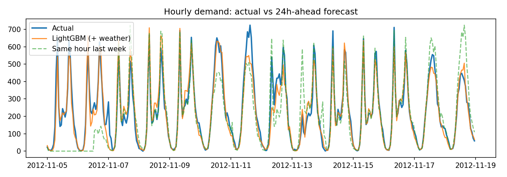
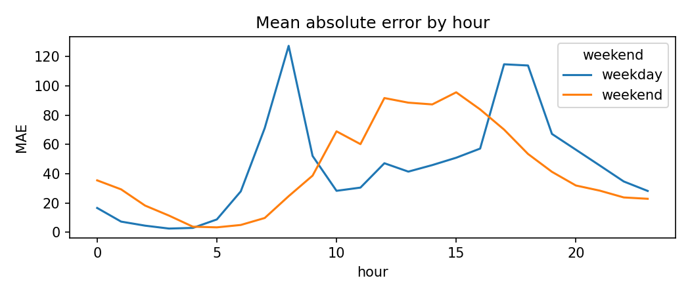
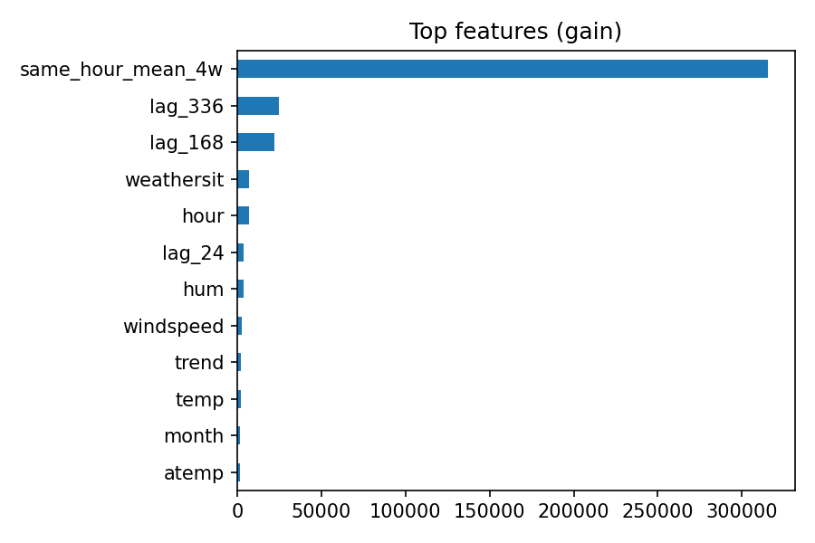
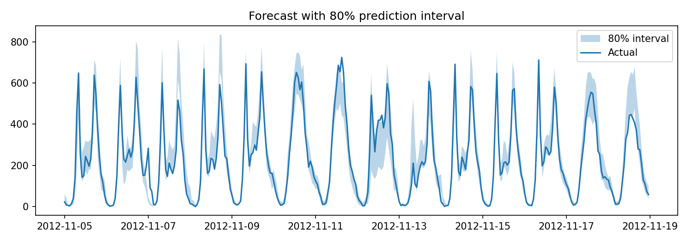

# Demand Forecasting: Next-Day Hourly Demand with LightGBM

Forecasting **hourly demand 24 hours ahead** so operations teams can plan capacity (staffing, stock, liquidity). The project compares gradient boosting against the simple rules many teams still rely on, and adds **prediction intervals** for planning under uncertainty.

**Data:** UCI Bike Sharing dataset, about 17,500 hours of rentals in Washington D.C. (2011–2012), with calendar and weather features.

## Approach
- **Clean hourly series.** The raw data skips 165 hours, so I re-indexed it to a complete hourly calendar, which keeps lag features correct in real hours.
- **Leak-free features.** The forecast is made a day ahead, so every feature is available 24 h in advance: lags at 24 h, 48 h, 1 week and 2 weeks; rolling weekly level and volatility; a 4-week same-hour average; and calendar features.
- **Time-based split.** Train: Jan 2011–Jun 2012. Validation: Jul–Sep 2012. Test: Oct–Dec 2012.
- **Model.** LightGBM trained on log(1+demand) to handle skew, with early stopping on validation, then refit on train+validation.
- **Metrics.** MAE, RMSE and **WAPE**. MAPE was not used because it breaks when night-time demand is close to zero.
- **Uncertainty.** Quantile LightGBM models at the 10th and 90th percentiles produce an 80% prediction interval.

## Results (test set: Oct–Dec 2012)

| Model | MAE | RMSE | WAPE |
|---|---|---|---|
| Naive: same hour yesterday | 77.2 | 128.9 | 0.359 |
| Naive: same hour last week | 75.9 | 129.8 | 0.353 |
| Naive: 4-week same-hour average | 63.7 | 112.2 | 0.296 |
| LightGBM (calendar + lags) | 55.7 | 90.9 | 0.259 |
| **LightGBM (+ weather)** | **44.5** | **70.5** | **0.207** |

**The best model cut error by 41% against the seasonal-naive baseline** (WAPE 0.353 → 0.207) and by 30% against the strongest naive rule.

## Key findings
1. **Weather matters.** Adding weather lowered WAPE from 0.259 to 0.207, a 20% improvement. Caveat: this dataset has *observed* weather, while a real system would use weather *forecasts*. That makes the calendar + lags model (WAPE 0.259) the honest lower bound on performance.
2. **Recent same-hour history dominates.** The 4-week same-hour average was by far the most important feature, ahead of the 1- and 2-week lags.
3. **Errors concentrate at peaks.** On weekdays, error spikes at the 8am and 5–6pm commuting peaks. On weekends it spreads across the afternoon leisure hours.
4. **The worst days are rare events.** The worst was 29–30 Oct 2012, when Hurricane Sandy shut the system down: actual demand was 22 rentals against a forecast of about 2,000. The next worst were 24–26 Dec, Christmas, which the model had no holiday feature for.

## Planning with uncertainty
The 80% prediction interval widens around peaks and on volatile days. Planners can staff to the upper bound at busy hours instead of relying on a single point forecast.

## Next steps
- Add a holiday and special-events calendar, plus a "disruption" flag for events like storms.
- Use weather *forecasts* instead of observed weather.
- Forecast hierarchically (for example per station, reconciled to the total), monitor drift, and retrain on a schedule.

## Run it
Open `Demand_Forecasting_LightGBM.ipynb` in Google Colab and click **Runtime → Run all**. The data downloads automatically from UCI.

**Stack:** Python, LightGBM, pandas, NumPy, scikit-learn, matplotlib
